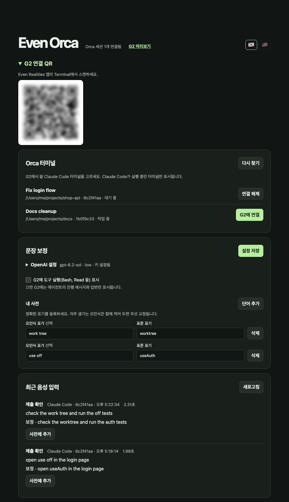
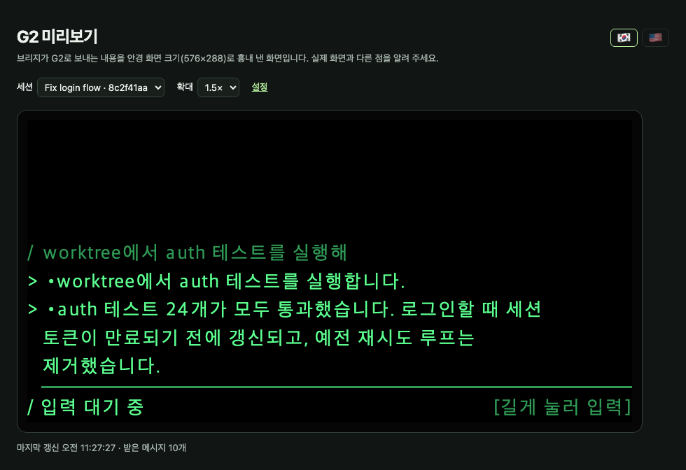

# Even Orca

Even Realities G2 안경으로 [Orca](https://github.com/stablyai/orca) 터미널의 코딩 에이전트와 대화합니다.

Even Orca는 Even Realities 앱의 Terminal 모드와 Orca에서 실행 중인 Claude Code·Codex 세션을 잇는 macOS용 브리지입니다. G2가 인식한 문장을 내 사전과 같은 세션의 최근 입력으로 보정해 선택한 세션에 제출하고, 에이전트의 진행 메시지와 답변을 안경으로 다시 보냅니다.

[English](README.md)

## 화면

**설정** — G2를 연결하고, G2에서 쓸 Orca 터미널을 고르고, 문장 보정을 설정합니다.



**G2 미리보기** — 안경에 보이는 내용을 G2 펌웨어 글꼴 정보로 Mac에서 다시 그립니다.



## 기능

- **문장 보정.** OpenAI 모델, 내 사전, 같은 세션의 최근 입력으로 음성 인식 오류를 고친 뒤 제출합니다. 숫자, 코드, 옵션, 부정 표현은 그대로 지키고, 보정에 실패하거나 안전하지 않은 결과는 제출하지 않습니다.
- **열려 있는 Orca 터미널에 연결.** Orca에서 이미 실행 중인 Claude Code 세션을 설정 화면에서 골라 바로 씁니다. 별도 명령이 필요 없습니다.
- **래퍼 모드.** `even-orca`로 Claude Code나 Codex를 실행하면 안경에서 권한 요청에 답하는 기능까지 Even Terminal을 모두 쓸 수 있습니다.
- **안전한 제출.** 요청마다 한 번만 제출하고, 전달이 불확실하면 다시 보내지 않으며, 에이전트가 작업 중이거나 권한 응답을 기다리면 제출을 보류합니다.
- **안경에서 읽기 쉽게.** 도구 실행 줄은 기본으로 숨겨 에이전트 진행 메시지가 묻히지 않게 하고, 답변 문단마다 `•`를 붙입니다.
- **G2 미리보기.** G2 펌웨어 글꼴 정보로 안경 화면(576×288)을 Mac에서 근사해 보여 줘서, 실제 화면을 캡처하지 않고도 배치를 확인할 수 있습니다.
- **설정 화면.** OpenAI 키·모델·reasoning effort, 사전, 최근 음성 입력, 연결 QR을 관리합니다. 한국어와 영어를 지원합니다.

## 요구 사항

- 휴대폰과 같은 사설 네트워크에 있는 macOS
- [Node.js](https://nodejs.org) 22.18 이상
- [Orca](https://github.com/stablyai/orca)와 `orca` CLI(앱에 포함)
- 로그인해 둔 [Claude Code](https://claude.com/claude-code)(`claude`) 또는 Codex CLI(`codex`)
- Even Realities G2 안경과 Terminal 모드가 있는 Even Realities 앱
- 문장 보정용 [OpenAI API 키](https://platform.openai.com/api-keys)

## 설치

```sh
git clone https://github.com/sayzard/even-orca.git ~/even-orca
cd ~/even-orca
npm ci
```

아래 예시는 저장소를 `~/even-orca`에 받았다고 가정합니다.

## 사용법

### 1. 브리지 실행

```sh
npm start
```

브리지가 연결 QR, 설정 화면 주소, Orca에서 찾은 Claude Code 터미널 목록을 출력합니다.

### 2. OpenAI API 키 입력

Mac에서 설정 화면 <http://127.0.0.1:3466>을 엽니다. **문장 보정 → OpenAI 설정**에 API 키를 입력하고 **설정 저장**을 누릅니다. 키는 프로젝트의 `.env` 파일에 저장되고, 설정 화면에서 다시 읽을 수 없습니다. 키를 넣기 전까지 안경에서 보낸 입력은 보류됩니다.

### 3. G2 연결

Even Realities 앱의 **Terminal**에서 설정 화면(또는 터미널 출력)의 **G2 연결 QR**을 스캔합니다. 연결 정보는 브리지를 다시 시작해도 유지됩니다.

### 4. 에이전트 세션 연결

**열려 있는 Orca 터미널에 연결(Claude Code).** 설정 화면의 **Orca 터미널**에서 Claude Code 세션 옆의 **G2에 연결**을 누릅니다. 연결한 세션은 Even 앱에 나타나고, 브리지를 다시 시작해도 Orca에 열려 있으면 다시 연결됩니다.

**또는 래퍼로 실행.** 작업할 워크스페이스의 Orca 터미널에서 실행합니다.

```sh
~/even-orca/bin/even-orca.mjs claude
~/even-orca/bin/even-orca.mjs codex
```

기존 대화를 열려면 세션 ID를 지정합니다. 같은 세션을 연 다른 CLI가 있으면 먼저 종료합니다.

```sh
~/even-orca/bin/even-orca.mjs claude --resume <session-id>
~/even-orca/bin/even-orca.mjs codex resume <session-id>
```

그다음 Even 앱에서 세션을 고르고 말하면 됩니다. 말하기 전에 Orca 입력창에 쓰던 문장은 제출하거나 지워 두세요.

### 5. 화면 확인(선택)

**G2 미리보기** <http://127.0.0.1:3466/preview>를 엽니다. 브리지가 안경으로 보내는 내용을 G2 펌웨어 글자 폭, 단어 단위 줄바꿈, Terminal 모드 표시(답변 `>`, 내 입력 `/`)로 다시 그립니다.

## 설정

### 설정 화면

| 항목 | 설명 |
| --- | --- |
| OpenAI API 키 | 저장만 가능합니다. `.env`의 `EVEN_ORCA_OPENAI_API_KEY`로 저장하며, 저장 전에 OpenAI에 키를 확인합니다. |
| OpenAI 모델 / reasoning effort | 보정에 쓰는 모델입니다. 기본값은 `gpt-6.2-sol` / `low`이고, 지연을 줄이려면 `gpt-6-luna` / `none`을 씁니다. |
| G2에 도구 실행 표시 | 기본으로 꺼져 있습니다. 켜면 `tool_start`/`tool_end` 이벤트를 안경으로 보냅니다. |
| 내 사전 | 정확한 표기(예: `worktree`, `useAuth`)와, 필요하면 자주 잘못 인식되는 형태를 등록합니다. |
| 최근 음성 입력 | 원문, 보정문, 처리 시간, 제출 상태를 보여 줍니다. |

설정은 `~/.config/even-orca/settings.json`에 저장됩니다.

### 환경 변수

`.env`([`.env.example`](.env.example) 참고)나 환경 변수로 지정합니다.

| 변수 | 기본값 | 설명 |
| --- | --- | --- |
| `EVEN_ORCA_OPENAI_API_KEY` | — | OpenAI API 키. 없으면 `OPENAI_API_KEY`를 씁니다. |
| `EVEN_ORCA_PORT` | `3466` | 브리지 포트 |
| `EVEN_ORCA_CODEX_PORT` | `8766` | 로컬 Codex 앱 서버 포트 |
| `EVEN_ORCA_LAN` | 첫 사설 IPv4 | 휴대폰이 접속할 LAN 주소. `off`면 Mac 전용 모드 |
| `EVEN_ORCA_PROVIDER` | `claude` | 기본 에이전트: `claude` 또는 `codex` |
| `EVEN_ORCA_ORCA_BIN` | Orca 앱 번들 | `orca` CLI 경로 |
| `EVEN_ORCA_STATE_DIR` | `~/.config/even-orca` | 설정, 연결 정보, 연결한 세션을 저장하는 위치 |

## 동작 방식

```
 G2 안경 ⇄ Even 앱(Terminal 모드) ⇄ Even Orca 브리지(Mac) ⇄ Orca의 Claude Code / Codex
                                         │
                                         └─ OpenAI(문장 보정에만 사용)
```

1. Even 앱이 음성을 녹음·인식해 문장을 로컬 네트워크로 브리지에 보냅니다.
2. 브리지는 사전을 적용하고, 같은 세션의 최근 입력을 함께 보내 OpenAI에 최소한의 수정을 받은 뒤, 숫자·코드·의미를 바꾸는 수정은 거부합니다.
3. 보정한 문장을 한 번만 제출합니다. 래퍼 세션은 Even Terminal 래퍼로, 연결한 Orca 터미널은 `orca terminal send`로 보냅니다.
4. 답변은 에이전트의 대화 기록에서 읽어 안경으로 보냅니다.

Even Terminal 프로토콜은 [`@evenrealities/even-terminal`](https://www.npmjs.com/package/@evenrealities/even-terminal)을 사용합니다. 연결할 세션은 Orca CLI와 Claude Code의 세션 기록으로 찾습니다.

## 개인정보와 보안

- OpenAI에는 인식한 문장, 관련 사전 항목, 같은 세션의 최근 입력 최대 5건만 보냅니다. 에이전트 답변과 오디오는 보내지 않습니다.
- 설정 화면, 미리보기, 키 저장 기능은 `127.0.0.1`에서만 열립니다. LAN의 휴대폰용 API는 연결 토큰이 있어야 쓸 수 있습니다.
- Orca가 Claude Code 실행 중으로 표시한 터미널만 연결할 수 있어서, 음성 문장이 일반 쉘에서 명령으로 실행되지 않습니다.

## 제한 사항

- 열려 있는 Orca 터미널에 연결하는 기능은 Claude Code만 지원합니다. Codex는 래퍼를 쓰세요.
- 연결한 세션의 권한 요청, 선택 질문, 중단은 Orca에서 직접 처리합니다. 안경에는 알림이 표시됩니다.
- 세션 찾기는 Claude Code의 로컬 세션 기록에 기대므로, Claude Code 버전에 따라 바뀔 수 있습니다.
- G2 미리보기는 근사치입니다. 글자 모양은 Mac 글꼴이고, 가끔 한 단어 정도 줄바꿈이 다를 수 있습니다.

## 개발

```sh
npm run check        # 타입 검사
npm test             # 단위·통합 테스트
npm run screenshots  # 예시 데이터로 docs/images 다시 생성(Google Chrome 필요)
```

테스트는 보정 안전장치, 한 번만 제출, Even Terminal 래퍼 프로토콜, 가짜 Orca CLI로 하는 터미널 연결, 저장만 되는 키 관리를 확인합니다.

## 라이선스

[MIT](LICENSE)

Even Terminal 프로토콜은 [`@evenrealities/even-terminal`](https://www.npmjs.com/package/@evenrealities/even-terminal)을 npm에서 받아 그 패키지의 조건에 따라 씁니다. G2 글꼴 정보는 [`@evenrealities/pretext`](https://www.npmjs.com/package/@evenrealities/pretext)(MIT)를 씁니다. 두 패키지 모두 이 저장소에 포함되어 있지 않습니다. Even Realities, G2, Orca, Claude Code, Codex는 각 소유자의 상표이며, 이 프로젝트는 그들과 관련이 없습니다.
