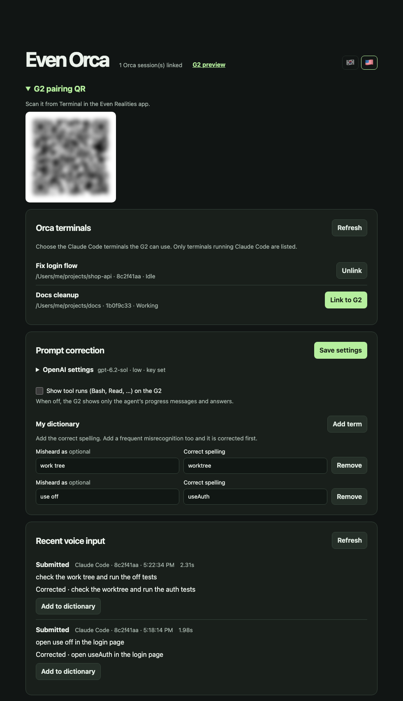
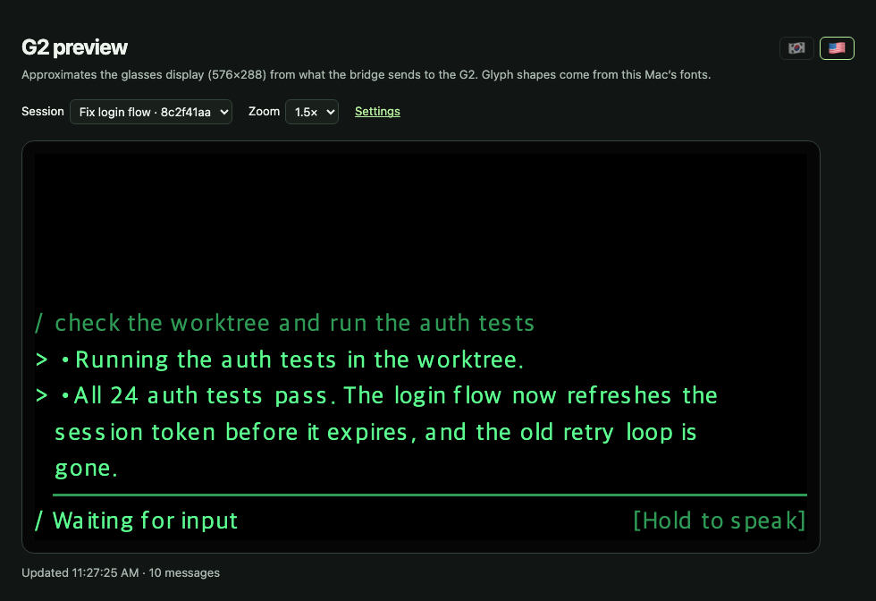

# Even Orca

Talk to the coding agents in your [Orca](https://github.com/stablyai/orca) terminals from Even Realities G2 glasses.

Even Orca is a small macOS bridge between the Terminal mode of the Even Realities app and Claude Code or Codex sessions running in Orca. It cleans up what the G2 heard, using your own dictionary and the recent prompts of the same session, submits the prompt to the chosen session, and streams the agent's progress and answers back to the glasses.

[한국어](README.ko.md)

## Screenshots

**Settings** — pair the G2, choose which Orca terminals it can use, and configure prompt correction.



**G2 preview** — what the glasses show, redrawn on the Mac with the G2 firmware font metrics.



## Features

- **Prompt correction.** Fixes speech-recognition errors before submitting, using an OpenAI model, a personal dictionary, and the last prompts of the same session. Numbers, code literals, flags, and negations are preserved; a failed or unsafe correction is never submitted.
- **Attach to open Orca terminals.** Pick any Claude Code session already running in Orca from the settings page. No wrapper command needed.
- **Wrapper mode.** Launch Claude Code or Codex through `even-orca` for full Even Terminal support, including answering permission prompts from the glasses.
- **Safe delivery.** One submission per request, no resends after an uncertain write, and prompts are held while the agent is busy or waiting for a permission answer.
- **Readable on the glasses.** Tool-run lines are hidden by default so the agent's narration stays visible, and each answer paragraph starts with a `•` marker.
- **G2 preview.** A Mac page that approximates the glasses display (576×288), using the G2 firmware font metrics, so you can check layout without capturing the real screen.
- **Settings page.** OpenAI key, model, and reasoning effort; dictionary; recent voice input; pairing QR. Available in English and Korean.

## Requirements

- macOS on the same private network as your phone
- [Node.js](https://nodejs.org) 22.18 or later
- [Orca](https://github.com/stablyai/orca), with the `orca` CLI (bundled with the app)
- [Claude Code](https://claude.com/claude-code) (`claude`) or the Codex CLI (`codex`), already signed in
- Even Realities G2 glasses and the Even Realities app with Terminal mode
- An [OpenAI API key](https://platform.openai.com/api-keys) for prompt correction

## Installation

```sh
git clone https://github.com/sayzard/even-orca.git ~/even-orca
cd ~/even-orca
npm ci
```

The examples below assume the repository lives in `~/even-orca`.

## Usage

### 1. Start the bridge

```sh
npm start
```

The bridge prints a pairing QR code, the settings URL, and the Claude Code terminals it found in Orca.

### 2. Add your OpenAI API key

Open the settings page at <http://127.0.0.1:3466> on the Mac. Under **Prompt correction → OpenAI settings**, enter your API key and select **Save settings**. The key is written to the project's `.env` file and cannot be read back from the page. Until a key is set, prompts from the glasses are held.

### 3. Pair the G2

In the Even Realities app, open **Terminal** and scan the **G2 pairing QR** from the settings page (or from the terminal output). Pairing is kept across bridge restarts.

### 4. Connect an agent session

**Attach to an open Orca terminal (Claude Code).** In **Orca terminals** on the settings page, select **Link to G2** next to a Claude Code session. Linked sessions appear in the Even app and are linked again when the bridge restarts, as long as they are still open in Orca.

**Or launch through the wrapper.** In an Orca terminal, in the workspace you want to work in:

```sh
~/even-orca/bin/even-orca.mjs claude
~/even-orca/bin/even-orca.mjs codex
```

To reopen an existing conversation, pass its session ID. Close any other CLI instance that has the same session open first.

```sh
~/even-orca/bin/even-orca.mjs claude --resume <session-id>
~/even-orca/bin/even-orca.mjs codex resume <session-id>
```

Then select the session in the Even app and speak. Before dictating, submit or clear any text you have typed into the Orca prompt.

### 5. Check the display (optional)

Open the **G2 preview** at <http://127.0.0.1:3466/preview>. It redraws what the bridge sends to the glasses with the G2 firmware glyph widths, word wrapping, and the Terminal mode markers (`>` for answers, `/` for your prompts).

## Configuration

### Settings page

| Setting | Description |
| --- | --- |
| OpenAI API key | Write-only. Stored in `.env` as `EVEN_ORCA_OPENAI_API_KEY`. Checked against OpenAI before saving. |
| OpenAI model / reasoning effort | Model used for correction. Defaults to `gpt-6.2-sol` with `low`; `gpt-6-luna` with `none` favors latency. |
| Show tool runs on the G2 | Off by default. When on, `tool_start`/`tool_end` events are sent to the glasses. |
| My dictionary | Correct spellings (for example `worktree`, `useAuth`), optionally with how they are usually misheard. |
| Recent voice input | Raw and corrected text, processing time, and delivery status. |

Settings are stored in `~/.config/even-orca/settings.json`.

### Environment variables

Set these in `.env` (see [`.env.example`](.env.example)) or in the environment.

| Variable | Default | Description |
| --- | --- | --- |
| `EVEN_ORCA_OPENAI_API_KEY` | — | OpenAI API key. `OPENAI_API_KEY` is used as a fallback. |
| `EVEN_ORCA_PORT` | `3466` | Bridge port. |
| `EVEN_ORCA_CODEX_PORT` | `8766` | Local Codex app-server port. |
| `EVEN_ORCA_LAN` | first private IPv4 | LAN address for the phone, or `off` for Mac-only mode. |
| `EVEN_ORCA_PROVIDER` | `claude` | Default agent: `claude` or `codex`. |
| `EVEN_ORCA_ORCA_BIN` | Orca app bundle | Path to the `orca` CLI. |
| `EVEN_ORCA_STATE_DIR` | `~/.config/even-orca` | Where settings, pairing, and linked sessions are stored. |

## How it works

```
 G2 glasses ⇄ Even app (Terminal mode) ⇄ Even Orca bridge (Mac) ⇄ Claude Code / Codex in Orca
                                            │
                                            └─ OpenAI (prompt correction only)
```

1. The Even app records your voice, recognizes it, and sends the text to the bridge over the local network.
2. The bridge applies your dictionary, asks OpenAI for minimal edits using the session's recent prompts, and rejects edits that change numbers, code, or meaning.
3. The corrected prompt is submitted once: through the Even Terminal wrapper, or with `orca terminal send` for attached Orca terminals.
4. Replies are read from the agent's transcript and streamed back to the glasses.

The Even Terminal protocol comes from [`@evenrealities/even-terminal`](https://www.npmjs.com/package/@evenrealities/even-terminal). Attached sessions are discovered through the Orca CLI and Claude Code's session records.

## Privacy and security

- OpenAI receives only the recognized sentence, matching dictionary entries, and up to five recent prompts from the same session. Agent answers and audio are never sent.
- The settings page, preview, and key endpoint listen on `127.0.0.1` only. The phone API on the LAN requires the pairing token.
- Only terminals that Orca reports as running Claude Code can be linked, so dictated text never goes to a plain shell.

## Limitations

- Attaching to open Orca terminals supports Claude Code only. Use the wrapper for Codex.
- For attached sessions, permission prompts, questions, and interrupts are answered in Orca; the glasses show a notification.
- Session discovery relies on Claude Code's local session records, which may change between Claude Code versions.
- The G2 preview is an approximation: glyph shapes come from the Mac's fonts, and a line may occasionally wrap one word differently.

## Development

```sh
npm run check        # type-check
npm test             # unit and integration tests
npm run screenshots  # regenerate docs/images with demo data (needs Google Chrome)
```

Tests cover correction safeguards, single delivery, the Even Terminal wrapper protocol, Orca attach with a simulated Orca CLI, and the write-only key store.

## License

[MIT](LICENSE)

The Even Terminal protocol comes from [`@evenrealities/even-terminal`](https://www.npmjs.com/package/@evenrealities/even-terminal), installed from npm under its own terms. G2 font metrics come from [`@evenrealities/pretext`](https://www.npmjs.com/package/@evenrealities/pretext) (MIT). Neither package is redistributed in this repository. Even Realities, G2, Orca, Claude Code, and Codex are trademarks of their respective owners; this project is not affiliated with them.
